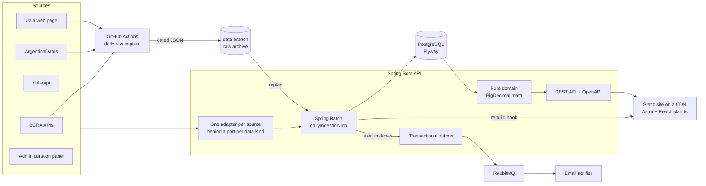

# rindetuplata

[](https://github.com/Mateocas1/rindetuplata/actions/workflows/java-test.yml)
[](https://github.com/Mateocas1/rindetuplata/actions/workflows/web-test.yml)
[](https://github.com/Mateocas1/rindetuplata/actions/workflows/capture-test.yml)
[](https://github.com/Mateocas1/rindetuplata/actions/workflows/daily-capture.yml)

**¿Dónde rinde tu plata hoy?** An Argentine yield comparator that ranks plazo fijo by bank, money-market
funds, remunerated wallets and fintech yields by the **pesos you earn for your amount and your term**, and by
**real return**: how much each option beats or loses to inflation.

With monthly inflation near 2%, a headline rate means little on its own. A 19% TNA wallet and a 24% TNA
plazo fijo look close on paper; one of them loses to expected inflation over 30 days. The product makes that
visible, row by row, with the source and the date of every number.

> Status: MVP complete. Ingestion, ranking API, magic-link alerts, the "Cobalto Cristal" static site and the
> deploy recipe all work end to end, and a private, unlisted preview runs on the owner's machine behind
> Tailscale Funnel for a few testers. A public launch and a UI/UX polish pass are future work.
> Scope and progress: [`odd/tasks/rindetuplata-mvp.md`](odd/tasks/rindetuplata-mvp.md).

## Numbers from a real run

Snapshot of `GET /api/v1/ranking` for **ARS 1,000,000 for 30 days, non-client rates**, from one LIVE
ingestion (capture date **2026-10-14**). Expected inflation: BCRA REM 21.1% over 12 months (observation
2026-09-30), compounded to **1.59% over 30 days**. These are recorded fixtures
([`web/fixtures/`](web/fixtures/README.md)), not live data: rates change every day.

| # | Instrument | Kind | Rate used | Earned in 30 days | Real return | Source |
|---|---|---|---|---|---|---|
| 1 | REBA COMPAÑIA FINANCIERA S.A. | Plazo fijo | 24.00% TNA | ARS 19,726.03 | +0.38% | ArgentinaDatos |
| 2 | Adcap Ahorro Dinámico Fondo de Dinero - Clase G | Money-market fund | 23.58% TNA equiv. | ARS 19,566.39 | +0.36% | ArgentinaDatos |
| 3 | Pellegrini Liquidez Pesos Clase A | Money-market fund | 23.29% TNA equiv. | ARS 19,321.91 | +0.34% | ArgentinaDatos |
| 4 | BANCO CMF S.A. | Plazo fijo | 23.50% TNA | ARS 19,315.07 | +0.34% | ArgentinaDatos |
| 5 | BANCO VOII S.A. | Plazo fijo | 23.50% TNA | ARS 19,315.07 | +0.34% | ArgentinaDatos |

The wallets in the same run show why the fine print is modeled, not ignored:

| Wallet | Rate used | Earned in 30 days | Real return | Confidence |
|---|---|---|---|---|
| Naranja X | 20.00% TNA, capped at ARS 1,000,000 | ARS 16,438.36 | +0.06% | Curated by hand, verified 2026-10-13 |
| Mercado Pago | 18.80% TNA equiv. of its fund class | ARS 15,571.75 | −0.03% | Derived from the FCI's daily quotes |
| Ualá | 19.00% TNA base; up to ARS 19,915.26 "si sumás $500.000" | ARS 15,460.27 | −0.04% | Scraped from the entity's web page |

In that run, 398 instruments were ranked and 259 were excluded with a reason (invalid or stale data, out of the
saver persona). Of the top 200, **79 lose to expected inflation** over the 30 days.

| Project figure | Value |
|---|---|
| External sources behind adapters | 9 (BCRA transparency and statistics, ArgentinaDatos, dolarapi, Ualá, curated rates) |
| Sources archived daily from day one | 4 (those whose history cannot be recovered later) |
| Backend tests (JUnit 5 + Testcontainers) | 450 |
| Frontend tests (Vitest) | 398, plus a Playwright end-to-end smoke over the full Compose stack |

## What it does

- **Personalized ranking.** Every instrument is simulated for your amount and term, with its caps, tiers,
  minimum amounts and minimum terms applied; ineligible ones are listed with the reason, never dropped
  silently. "Soy cliente de…" switches plazo fijo to client rates for your banks.
- **Real return with two indices.** Today's ranking and the simulator use BCRA REM expected inflation, converted
  to your horizon by compounding (never divided linearly); history uses past INDEC inflation. The UI always says
  which index it used.
- **History.** Built by our own daily ingestion, since no source keeps per-bank or per-wallet history.
- **Alerts.** Passwordless magic-link login; "tell me when a wallet goes above X% a year" by email.
- **API keys.** A signed-in user creates up to 3 keys at `/claves-api/` and sends one as `X-Api-Key` to get its own
  rate limit and daily quota on the public read API ([`docs/api-keys.md`](docs/api-keys.md)).
- **MCP and `llms.txt`.** A read-only MCP server (`POST /mcp`, stateless Streamable HTTP) lets an AI assistant ask
  the same ranking, simulate one instrument, read its history and the monthly reports; the site serves `/llms.txt`
  for crawlers and assistants. See [`docs/mcp.md`](docs/mcp.md).
- **Honest data.** Each rate carries its source, its data date and a confidence level (official automatic,
  aggregator automatic, scraped from the entity's web page, curated by hand with a verified-at date). Stale data
  is shown flagged, never as current.

## Architecture



- **Ingestion** (`ingest`, `source`, `store`): one Spring Batch job instance per data date, so re-running a day
  never duplicates snapshots. Each data kind is one step; a failing source is recorded and never blocks the
  others. The same job replays the raw archive for past dates.
- **Domain** (`domain`): pure Java, no Spring. TNA to TEA, simple and compound interest, daily accrual with caps
  and tiers, fund yield from cuotaparte deltas, REM horizon conversion, real return. `BigDecimal` with explicit
  `MathContext` and rounding, tested against hand-computed values.
- **Read side** (`ranking`, `api`): turns stored snapshots into domain instruments and simulates them per
  request; ProblemDetail errors; OpenAPI at `/v3/api-docs`. `GET /api/v1/simulations` reads only the requested
  instrument. Every ranked and simulated entry carries `breakEvenMep { devaluation, price }` (the MEP buy price
  may rise less than `(1 + r) * sell / buy - 1` for the instrument to beat the dollar; break-even price
  `(1 + r) * sell`) and the response carries the `dollarMep` quote it used, the latest stored one at or before
  `asOf`; both are `null` when no quote is stored. `GET /api/v1/ranking` is cached in process (LRU, 64 entries by default) per data version and
  resolved query. The data version is one aggregate read from the database on every request (`source_run`,
  curated wallet rates and their audit, newest instrument), so the daily job, the startup ingestion, a backfill
  and a curation save all invalidate it with no event bus. Both endpoints send a weak `ETag` (data version +
  normalized request) and `Cache-Control: public, no-cache`; a matching `If-None-Match` is a `304` with no body
  and no ranking work, and a new ingestion run or curated rate gives a new tag.
- **Accounts and alerts** (`account`, `alert`, `curation`): Spring Security one-time-token login, JDBC sessions,
  CSRF for a cross-origin SPA, admin role; alert rules evaluated after each ingestion, written to an outbox in
  the same transaction and relayed to RabbitMQ with publisher confirms, an idempotent consumer and a
  dead-letter queue.
- **Site** (`web/`): Astro static pages with React islands for the simulator and account pages; build-time SVG
  history charts, per-page SEO, sitemap and JSON-LD. No financial math in the browser: it all lives in the API.

### Daily raw capture

Some sources only expose today's value (plazo fijo by entity, wallet and fintech yields), so history lost on a
missed day cannot be recovered. A scheduled GitHub Actions workflow
(`.github/workflows/daily-capture.yml`) archives those responses every day at 12:00 Argentina time on the
orphan [`data`](../../tree/data) branch, under `raw/YYYY/MM/DD/`, with a `manifest.json` per day (status, size
and sha256 per source). A failing source never blocks the others and never deletes an earlier good capture of
the same day; the workflow fails so the owner gets notified.

## Stack

Java 21 · Spring Boot 4.1 · Spring Batch 6 · Spring Security 7 · PostgreSQL 18 · Flyway · RabbitMQ ·
JUnit 5 · Testcontainers · Astro 7 · React 19 · Tailwind 4 · Vitest · Playwright · Docker Compose · Caddy ·
GitHub Actions

## Run

Requires Java 21 and Docker (the Maven wrapper downloads Maven).

```bash
./mvnw test                         # backend tests; Testcontainers starts PostgreSQL and RabbitMQ
./mvnw spring-boot:test-run         # API on :8080 with a Testcontainers PostgreSQL
(cd web && npm ci && npm test)      # frontend tests (Node 24)
(cd web && WEB_FIXTURES=1 npm run build)  # build the site from the recorded fixtures
capture/test/capture_test.sh        # raw capture tests (bash + jq + python3, no network)
```

The full local stack (API, site, PostgreSQL, RabbitMQ, Mailpit), the private preview
(`deploy/preview.sh`: Compose overlay, Caddy with `noindex`, a sidecar that rebuilds the site after each ingestion,
Tailscale Funnel on/off) and the VPS + CDN recipe are in [`docs/deploy.md`](docs/deploy.md).

### Performance

Load test of the public read API with [k6](https://k6.io) (v2.3.0): [`perf/read-api.js`](perf/read-api.js) mixes
`GET /api/v1/ranking` (default, amount/days combinations, `kind` filters, `groupFunds=false`, `limit=200`),
`GET /api/v1/simulations` (a ranked plazo fijo, fund class, wallet and crypto yield, with four amount/days shapes) and
a revalidation scenario that repeats the default ranking with the `If-None-Match` of its first answer. Every request
is tagged by endpoint and query shape; thresholds fail the run on any error, on a p95 above 10 s and on a single 429.

```bash
perf/run.sh after            # label of the result files; use `before` to repeat the baseline
OUT_DIR=perf/results perf/run.sh after   # keep <label>.json (full k6 summary) and <label>.txt
```

`perf/run.sh` is self-contained and stops everything it starts, even on failure. It takes
`/tmp/rindetuplata-maven.lock` for the whole run, builds the jar, starts PostgreSQL 18 (Docker, `127.0.0.1:55432`) and
`perf/mock_sources.py` (a local stand-in for the external sources, `127.0.0.1:18081`), starts the jar with
`RINDETUPLATA_INGEST_RUNONSTARTUP=true` so the application ingests "today" exactly as the daily job does, seeds the
fund history ([`perf/seed-fund-history.sql`](perf/seed-fund-history.sql)) and runs k6 with fixed VUs and duration.
No live HTTP is involved. Environment variables (`RANKING_VUS`, `SIMULATION_VUS`, `REVALIDATE_VUS`, `DURATION`,
`FUND_CLASSES`, `DATA_DAY`, `JAVA_OPTS`) change the scenario; keep the defaults to compare runs.

**Rate limit.** The read API answers 429 past 120 requests per address. The run starts the application with
`RINDETUPLATA_API_RATELIMIT_BYPASSTOKEN` and k6 sends the same value as `X-Build-Token`, the bypass the static site
build uses ([`docs/deploy.md`](docs/deploy.md), "Build token"). A 429 is never counted as a success: it is an error in
the endpoint's rate and the run fails if there is one (0 in the baseline).

**Data of the run** (what is recorded and what is synthetic, so the numbers can be judged):

| Kind | Instruments | Origin |
|---|---|---|
| Plazo fijo, BCRA transparency | 694 | Recorded: `data` branch capture of 2026-10-31 |
| Plazo fijo, ArgentinaDatos banks | 33 | Recorded: same capture |
| Crypto and fintech yields | 64 | Recorded: same capture |
| Wallets | 2 | Ualá from the hand-trimmed fixture page (not a recording); Naranja X from the curated rates that ship with the app |
| Money-market fund classes | 620 | 32 recorded classes of the 2026-10-09 fixture (5 of them dead), re-dated to the last two business days, plus 588 synthetic classes (the source lists about 620 and no archive holds them) |
| Fund quotes | 9,850 rows | 8,610 synthetic back-filled business days (21 days before each class's last quote, on the geometric curve through its two quotes); the other 1,240 are each class's latest and previous quote (synthetic for the 588 synthetic classes) |
| Macro and dollar | | Recorded fixtures: REM 12-month expectation, INDEC monthly inflation, PSP benchmark, MEP dollar |

The ingestion ran on 2026-11-01 (every snapshot has that capture date; fund quotes are dated 2026-10-29 and
2026-10-30). `GET /api/v1/ranking` then returns 232 ranked rows with funds grouped (638 with `groupFunds=false`) and 14
excluded. The 2026-10-14 snapshot in the section above is a different, live recording.

**Before and after**. Before (baseline, no T3a): commit `19e19f0`, 8 ranking + 4 simulation + 2 revalidation virtual users for 60 s
(14 concurrent users, no think time, so req/s is the capacity of the application), JVM `-Xms1g -Xmx1g`, AMD Ryzen 5 7600
(6 cores, 12 threads), 14 GB RAM, Linux 7.2.8, Temurin 21.0.13, PostgreSQL 18 and the application on the same machine
as k6 (a shared development machine: expect a few percent of run-to-run noise). After: commit `45b4f77` (T3a), the
same data, machine, VUs, duration and command (`OUT_DIR=perf/results perf/run.sh after`).

| Endpoint | Run | Requests | req/s | p50 | p95 | p99 | Errors |
|---|---|---|---|---|---|---|---|
| `GET /api/v1/ranking` | before | 4,856 | 80.7 | 108.1 ms | 138.8 ms | 161.4 ms | 0.00% |
| | after (T3a) | 288,193 | 4,795.2 | 1.2 ms | 2.3 ms | 3.3 ms | 0.00% |
| `GET /api/v1/simulations` | before | 2,355 | 39.1 | 99.1 ms | 128.4 ms | 151.1 ms | 0.00% |
| | after (T3a) | 81,018 | 1,348.1 | 2.5 ms | 4.9 ms | 6.2 ms | 0.00% |
| `GET /api/v1/ranking` with `If-None-Match` | before | 544 | 9.0 | 107.5 ms | 136.7 ms | 158.0 ms | 0.00% (0 of 544 answered 304: no ETag yet) |
| | after (T3a) | 46,763 | 778.1 | 1.0 ms | 1.8 ms | 2.6 ms | 0.00% (46,763 of 46,763 answered 304) |
| All requests | before | 7,759 | 128.9 | | | | 0.00%, 0 × 429 |
| | after (T3a) | 415,978 | 6,921.4 | | | | 0.00%, 0 × 429 |

Before T3a a single-instrument simulation cost as much as the whole ranking (99 ms against 108 ms at the median)
because `simulate()` built the full ranking. After it, the simulation reads only its instrument and the ranking is
served from the in-process cache after its first computation per data version and query, so the two endpoints went
from about 100 ms to 1-3 ms at the median, and every revalidation was a `304`.

Read these numbers as a best case. The ranking mix repeats 7 distinct queries, so almost every request after the first
seven is a cache hit; a mix with many distinct queries (every user typing a different amount and term) would hit the
cache far less and sit closer to the cost of one ranking, although the data-version read, the targeted simulation and
the 304 path stay cheap. The load is closed-loop with no think time, so req/s is capacity on one machine shared with
k6 and PostgreSQL, not a prediction for production traffic. The data version is still read from the database on every
request (one aggregate query), so a cache hit is not free; that cost was not profiled separately.

## Disclaimer

rindetuplata is **informational only and is not financial advice**. Rates come from public sources and from
the entities' own pages; they can be late, incomplete or wrong, and they change every day. Check the conditions
with the entity before you invest. Taxes are not modeled.

The ranking is neutral: no entity pays to appear, there are no affiliate links, and every row shows its source
and data date so the order can be checked.

## Highlights

Each line reads as what was achieved, how it is measured, and how it was built:

- **Ranks 398 savings options by real return for any amount and term**, by simulating every instrument
  with its caps, tiers and minimums in a pure-Java domain layer (`BigDecimal`, explicit rounding) tested
  against hand-computed values.
- **Re-running a day never duplicates data and one failing source never blocks the rest**, measured over
  9 external sources, by giving each date its own Spring Batch job instance and each source its own adapter
  behind a port.
- **No email alert is lost or sent twice**, by writing alert matches to a transactional outbox in the
  same transaction and relaying them to RabbitMQ with publisher confirms, an idempotent consumer and a
  dead-letter queue.
- **848 automated tests guard it** (450 JUnit 5 against real PostgreSQL and RabbitMQ in Testcontainers,
  398 Vitest, plus a Playwright end-to-end over the full Compose stack), run in GitHub Actions.

Case study: [mateocas1.github.io/portfolio/rindetuplata.html](https://mateocas1.github.io/portfolio/rindetuplata.html).
Built by Mateo with AI under Organic Driven Development: the specs, decisions and per-task evidence live in
[`odd/tasks/rindetuplata-mvp.md`](odd/tasks/rindetuplata-mvp.md).
