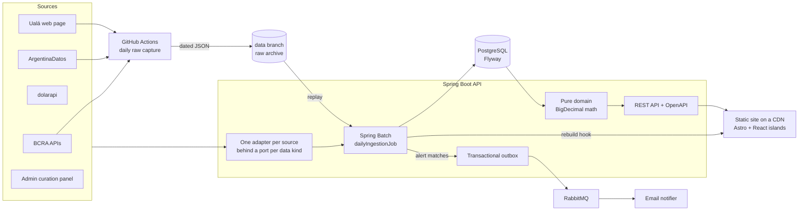

# rindetuplata

[](https://github.com/Mateocas1/rindetuplata/actions/workflows/java-test.yml)
[](https://github.com/Mateocas1/rindetuplata/actions/workflows/web-test.yml)
[](https://github.com/Mateocas1/rindetuplata/actions/workflows/capture-test.yml)
[](https://github.com/Mateocas1/rindetuplata/actions/workflows/daily-capture.yml)

**¿Dónde rinde tu plata hoy?** An Argentine yield comparator that ranks plazo fijo by bank, money-market
funds, remunerated wallets and fintech yields by the **pesos you earn for your amount and your term**, and by
**real return**: how much each option beats or loses to inflation.

With monthly inflation near 2%, a headline rate means little on its own. A 19% TNA wallet and a 24% TNA
plazo fijo look close on paper; one of them loses to expected inflation over 30 days. The product makes that
visible, row by row, with the source and the date of every number.

> Status: MVP complete. Ingestion, ranking API, magic-link alerts, the "Cobalto Cristal" static site and the
> deploy recipe all work end to end, and a private, unlisted preview runs on the owner's machine behind
> Tailscale Funnel for a few testers. A public launch and a UI/UX polish pass are future work.
> Scope and progress: [`odd/tasks/rindetuplata-mvp.md`](odd/tasks/rindetuplata-mvp.md).

## Numbers from a real run

Snapshot of `GET /api/v1/ranking` for **ARS 1,000,000 for 30 days, non-client rates**, from one LIVE
ingestion (capture date **2026-10-14**). Expected inflation: BCRA REM 21.1% over 12 months (observation
2026-09-30), compounded to **1.59% over 30 days**. These are recorded fixtures
([`web/fixtures/`](web/fixtures/README.md)), not live data: rates change every day.

| # | Instrument | Kind | Rate used | Earned in 30 days | Real return | Source |
|---|---|---|---|---|---|---|
| 1 | REBA COMPAÑIA FINANCIERA S.A. | Plazo fijo | 24.00% TNA | ARS 19,726.03 | +0.38% | ArgentinaDatos |
| 2 | Adcap Ahorro Dinámico Fondo de Dinero - Clase G | Money-market fund | 23.58% TNA equiv. | ARS 19,566.39 | +0.36% | ArgentinaDatos |
| 3 | Pellegrini Liquidez Pesos Clase A | Money-market fund | 23.29% TNA equiv. | ARS 19,321.91 | +0.34% | ArgentinaDatos |
| 4 | BANCO CMF S.A. | Plazo fijo | 23.50% TNA | ARS 19,315.07 | +0.34% | ArgentinaDatos |
| 5 | BANCO VOII S.A. | Plazo fijo | 23.50% TNA | ARS 19,315.07 | +0.34% | ArgentinaDatos |

The wallets in the same run show why the fine print is modeled, not ignored:

| Wallet | Rate used | Earned in 30 days | Real return | Confidence |
|---|---|---|---|---|
| Naranja X | 20.00% TNA, capped at ARS 1,000,000 | ARS 16,438.36 | +0.06% | Curated by hand, verified 2026-10-13 |
| Mercado Pago | 18.80% TNA equiv. of its fund class | ARS 15,571.75 | −0.03% | Derived from the FCI's daily quotes |
| Ualá | 19.00% TNA base; up to ARS 19,915.26 "si sumás $500.000" | ARS 15,460.27 | −0.04% | Scraped from the entity's web page |

In that run, 398 instruments were ranked and 259 were excluded with a reason (invalid or stale data, out of the
saver persona). Of the top 200, **79 lose to expected inflation** over the 30 days.

| Project figure | Value |
|---|---|
| External sources behind adapters | 9 (BCRA transparency and statistics, ArgentinaDatos, dolarapi, Ualá, curated rates) |
| Sources archived daily from day one | 4 (those whose history cannot be recovered later) |
| Backend tests (JUnit 5 + Testcontainers) | 450 |
| Frontend tests (Vitest) | 398, plus a Playwright end-to-end smoke over the full Compose stack |

## What it does

- **Personalized ranking.** Every instrument is simulated for your amount and term, with its caps, tiers,
  minimum amounts and minimum terms applied; ineligible ones are listed with the reason, never dropped
  silently. "Soy cliente de…" switches plazo fijo to client rates for your banks.
- **Real return with two indices.** Today's ranking and the simulator use BCRA REM expected inflation, converted
  to your horizon by compounding (never divided linearly); history uses past INDEC inflation. The UI always says
  which index it used.
- **History.** Built by our own daily ingestion, since no source keeps per-bank or per-wallet history.
- **Alerts.** Passwordless magic-link login; "tell me when a wallet goes above X% a year" by email.
- **Honest data.** Each rate carries its source, its data date and a confidence level (official automatic,
  aggregator automatic, scraped from the entity's web page, curated by hand with a verified-at date). Stale data
  is shown flagged, never as current.

## Architecture



- **Ingestion** (`ingest`, `source`, `store`): one Spring Batch job instance per data date, so re-running a day
  never duplicates snapshots. Each data kind is one step; a failing source is recorded and never blocks the
  others. The same job replays the raw archive for past dates.
- **Domain** (`domain`): pure Java, no Spring. TNA to TEA, simple and compound interest, daily accrual with caps
  and tiers, fund yield from cuotaparte deltas, REM horizon conversion, real return. `BigDecimal` with explicit
  `MathContext` and rounding, tested against hand-computed values.
- **Read side** (`ranking`, `api`): turns stored snapshots into domain instruments and simulates them per
  request; ProblemDetail errors; OpenAPI at `/v3/api-docs`.
- **Accounts and alerts** (`account`, `alert`, `curation`): Spring Security one-time-token login, JDBC sessions,
  CSRF for a cross-origin SPA, admin role; alert rules evaluated after each ingestion, written to an outbox in
  the same transaction and relayed to RabbitMQ with publisher confirms, an idempotent consumer and a
  dead-letter queue.
- **Site** (`web/`): Astro static pages with React islands for the simulator and account pages; build-time SVG
  history charts, per-page SEO, sitemap and JSON-LD. No financial math in the browser: it all lives in the API.

### Daily raw capture

Some sources only expose today's value (plazo fijo by entity, wallet and fintech yields), so history lost on a
missed day cannot be recovered. A scheduled GitHub Actions workflow
(`.github/workflows/daily-capture.yml`) archives those responses every day at 12:00 Argentina time on the
orphan [`data`](../../tree/data) branch, under `raw/YYYY/MM/DD/`, with a `manifest.json` per day (status, size
and sha256 per source). A failing source never blocks the others and never deletes an earlier good capture of
the same day; the workflow fails so the owner gets notified.

## Stack

Java 21 · Spring Boot 4.1 · Spring Batch 6 · Spring Security 7 · PostgreSQL 18 · Flyway · RabbitMQ ·
JUnit 5 · Testcontainers · Astro 7 · React 19 · Tailwind 4 · Vitest · Playwright · Docker Compose · Caddy ·
GitHub Actions

## Run

Requires Java 21 and Docker (the Maven wrapper downloads Maven).

```bash
./mvnw test                         # backend tests; Testcontainers starts PostgreSQL and RabbitMQ
./mvnw spring-boot:test-run         # API on :8080 with a Testcontainers PostgreSQL
(cd web && npm ci && npm test)      # frontend tests (Node 24)
(cd web && WEB_FIXTURES=1 npm run build)  # build the site from the recorded fixtures
capture/test/capture_test.sh        # raw capture tests (bash + jq + python3, no network)
```

The full local stack (API, site, PostgreSQL, RabbitMQ, Mailpit), the private preview
(`deploy/preview.sh`: Compose overlay, Caddy with `noindex`, a sidecar that rebuilds the site after each ingestion,
Tailscale Funnel on/off) and the VPS + CDN recipe are in [`docs/deploy.md`](docs/deploy.md).

## Disclaimer

rindetuplata is **informational only and is not financial advice**. Rates come from public sources and from
the entities' own pages; they can be late, incomplete or wrong, and they change every day. Check the conditions
with the entity before you invest. Taxes are not modeled.

The ranking is neutral: no entity pays to appear, there are no affiliate links, and every row shows its source
and data date so the order can be checked.

## Portfolio

Built by Mateo with AI under Organic Driven Development: the specs, decisions and per-task evidence live in
[`odd/tasks/rindetuplata-mvp.md`](odd/tasks/rindetuplata-mvp.md).

> rindetuplata: an Argentine yield comparator in Java 21 / Spring Boot 4 that ranks nearly 400 savings instruments by
> real return against inflation, with idempotent Spring Batch ingestion from official sources, `BigDecimal`
> financial math, a transactional outbox to RabbitMQ for alerts, magic-link security, and an SEO-first
> Astro site.
